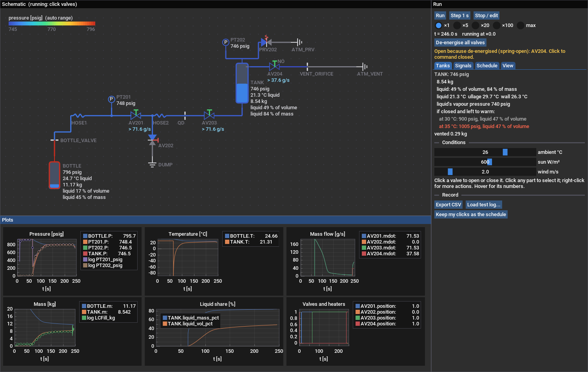

# n2o-fill-sim

> [!WARNING]
> **Experimental and unvalidated.** This is a research and learning tool, not an engineering
> one. Its results are model predictions that have been compared with four fill logs from one
> set of hardware, only one of which has a measured tank temperature. Do not use it to set fill
> quantities, pressures, relief settings, procedures or operating limits, or as the basis for
> any safety decision. Nitrous oxide is hazardous; work with it under your organisation's safety
> rules and qualified supervision.

A simulator for filling a hybrid rocket's nitrous oxide run tank. Draw the plumbing, press
Simulate, and click valves while it runs. It shows pressure, temperature, mass and flow
everywhere in the system, and how the tank responds when you vent, heat, wait in the sun, or
leave a valve stuck. Think of it as LTspice for a nitrous fill. It is useful in three ways:



- To build intuition for why a fill stalls, what a vent pulse actually buys, and how fast a
  closed tank warms. [docs/MODEL.md](docs/MODEL.md) starts with a plain-language account of the
  physics.
- To replay a real fill: load a telemetry log, run its valve sequence through the model, and see
  where the two agree and where they do not.
- To ask "what if": change a bore, a bottle temperature or the weather and run it again, once in
  the window or thousands of times from the command line.

It is an analysis tool. It does not talk to any control system or hardware.

## Quick start

You need Julia 1.13. It runs natively on Windows and Linux, and on WSL through WSLg.

```
git clone https://github.com/ari-kl/n2o-fill-sim
cd n2o-fill-sim
julia --project -e "using Pkg; Pkg.instantiate()"
```

On Windows, install Julia first (`winget install julia -s msstore`, then `juliaup add 1.13.4`).
After the lines above, double-click `n2o-fill-sim.cmd`, or from a terminal run
`n2o-fill-sim.cmd scenes\hf4.toml`.

On Linux or WSL, install [juliaup](https://github.com/JuliaLang/juliaup) first. Then:

```
julia --project bin/n2o-fill-sim.jl scenes/hf4.toml
```

The window appears about 3 s after launch. The first launch after installing or changing the code
compiles first, which can take a minute.

Nothing is fetched at run time. To use it somewhere without a network, run `Pkg.instantiate()`
for the project and for `test/` beforehand, start the program once, and set
`JULIA_PKG_OFFLINE=true`. `Manifest.toml` is committed, so every machine gets the same versions.

## First run

The repository includes a real fill to play with: `scenes/hf4.toml` is the fill plumbing of a
student hybrid motor's test stand, and `test/data/hf4_fill_10hz.csv` is the telemetry from a
static fire on it.

To watch a recorded fill, replay the logged valve sequence through the model. The logged
pressures and load cell are overlaid on the plots:

```
julia --project bin/n2o-fill-sim.jl scenes/hf4.toml --replay test/data/hf4_fill_10hz.csv --t0 9020 --run
```

Press `5` for maximum speed. You will see the fast fill, the stall as bottle and tank pressures
meet, two vent pulses with the pressure rebounding after each, and a slow climb under the heater.
Where the model's line leaves the logged one is where the model is wrong; MODEL.md says why for
each case.

To drive it yourself, open the scene without a replay, press Simulate, then `Space` to run.
Click the fill valves open and watch the tank fill and stall. Click the vent. Right-click a valve
and stick it open to see what a failure does. The Tanks tab shows what the present load would do
if the tank were sealed and left to warm to 30 °C and 35 °C.

To build your own plumbing, use Stop / edit to return to the editor. Pick parts from the palette, click to
place them, and click one pin and then another to wire them. A new, empty schematic offers the
example scenes to start from.

## Window

### Editing

Select a part to edit its parameters; hovering a parameter, or a part on the schematic, says what
it means. The Settings tab has the ambient conditions, an optional target pressure window (drawn
as a band on the pressure plot when both limits are set) and the model's tuning coefficients. The
Schedule tab is a table of scripted actions (time, part, action). Problems that would stop a run
are listed in red at the bottom of the Build tab.

| | |
|---|---|
| Select | click; shift-click to add or remove; drag a box over empty space; `Ctrl+A` for everything |
| Move, rotate, delete | drag the selection; `R`; `Delete` |
| Copy, paste, duplicate | `Ctrl+C`; `Ctrl+V` at the pointer; `Ctrl+D` in place |
| Wire corners | click a wire to add a corner and drag it; right-click a corner to remove it, a wire to cut it |
| Undo, redo | `Ctrl+Z`; `Ctrl+Y` or `Ctrl+Shift+Z`. A number typed into a box is one step |
| View | right-drag pans, the wheel zooms, `F` fits the schematic to the window |
| Files | `Ctrl+O`, `Ctrl+S` |

### Running

| | |
|---|---|
| Start, pause | Simulate starts the run paused; Run or `Space` |
| Speed | `1` to `5`: ×1, ×5, ×20, ×100, max |
| Step | "Step 1 s" runs one second at the chosen speed and pauses again |
| Valves | left-click opens or closes |
| Faults and set-points | right-click a part: stick a valve open or closed, switch a heater, change a set-point |
| Read a part | hover it for pressures, flow and temperature |
| Back to editing | Stop / edit. The plumbing cannot be changed during a run. |

If the simulation cannot keep up with the speed asked for, it falls behind instead of stuttering,
and the panel shows the speed achieved.

### Schematic symbols

| Symbol | Meaning |
|---|---|
| Valve drawn filled, with a bar across | shut |
| Valve drawn as an outline | open |
| Outline with part of the fill | part-way through its stroke |
| Arrow on the actuator | where the valve was told to go, until it gets there (outline pointing away: opening; filled pointing in: closing) |
| Check valve, relief valve, regulator | filled while nothing passes, outline while something does |

Red, green and amber say the same thing again in colour. A normally-open valve is open until
something commands it shut, as on a powered-down panel; the panel lists which valves are open for
that reason.

The View tab sets units and colours the plumbing by pressure, temperature or vapour share. Each
wire is one colour, because a wire has no pressure drop in this model; the step in colour across
a part is the drop that part causes.

### Tabs, CSV and picture export

The Tanks tab shows each tank's pressure, liquid share and temperatures, and the warm-soak
figures described above. The Signals tab plots any recorded signal.

"Export CSV" writes two files next to the scene:

- `NAME_run.csv`: every signal, in SI units. Per vessel: pressure, liquid/ullage/wall temperature,
  mass, level, liquid share by volume and by mass, vapour pressure of the liquid, heater on/off.
  Per flow part: mass flow. Per valve: `position` (0 shut to 1 open), `open_cmd` (1 = commanded
  open) and `stuck`. Regulator and relief set-points. Ambient temperature, sun and wind.
- `NAME_run_events.csv`: every valve, heater and set-point action with its time, whether scripted
  or clicked. Loaded as a schedule it repeats the run. "Keep my clicks as the schedule" does the
  same without leaving the window.

On WSL the window is software-rendered at 10-20 ms a frame; on Windows it draws on the GPU.

"Save pictures" writes the schematic and the plots as two PNG files next to the scene,
`NAME_schematic.png` and `NAME_plots.png`. Each is cut from the window as drawn, so zoom, colours,
units and plotted signals are whatever the window shows, at the window's size. While editing,
"Save picture" in the File section writes the schematic alone.

## Command line

`--headless` runs the schedule or a replay with no window and prints a summary. Changes go on the
command line, so a scene file does not have to be edited to try something:

```
julia --project bin/n2o-fill-sim.jl scenes/regulated_fill.toml --headless --until 1800 --csv out.csv

julia --project bin/n2o-fill-sim.jl scenes/hf4.toml --headless \
    --replay test/data/hf4_fill_10hz.csv --t0 9020 \
    --set VENT_ORIFICE.Cd=0.85 --set settings.interphase_E=300 \
    --csv out.csv --columns TANK.P,TANK.m
```

| Option | Does |
|---|---|
| `--set PART.param=value`, `--set settings.key=value` | changes one number; refuses a name that does not exist |
| `--schedule file.csv` | adds actions from a file with columns `t_s,part,action,value` (the format of the exported `_events.csv`) |
| `--until SECONDS` | where to stop; a replay otherwise runs to the end of its log |
| `--sample-dt SECONDS` | shortest interval between recorded samples (default 0.1 s) |
| `--csv file`, `--columns A,B` | write the recorded signals, or some of them |
| `--help` | every option |

Warnings, such as a heater that nothing switches on, are printed before the run. The HF4 fill, 16
minutes of real time, simulates in about a third of a second.

## Test logs

"Load test log..." or `--replay log.csv` reads a telemetry CSV. Pressure, mass and temperature
columns can be overlaid on the plots, together with what saturation implies: the saturation
temperature of a logged pressure, and the saturation pressure of a logged temperature. Valve and
heater columns are matched to parts by name and can be replayed as the schedule.

Check what a 1 means before replaying. Older logs (`valve_` columns) use 1 = open. Some later
logs write the same valves as `solenoid_` columns with 1 for a reported state of CLOSED.
`solenoid_` and `relay_` columns are therefore never replayed until you choose.

A log that needs more than guessing (several boards on different clocks, valve columns with
inverted meaning, bouncing states, offsets) is described once in a manifest and loaded with
`--manifest log.toml` or through the same dialog. [docs/LOGS.md](docs/LOGS.md) has the rules and
the manifest format.

Four logs come with the repository, as 10 Hz or 1 Hz extracts in `test/data`:

| Log | Scene | What it is |
|---|---|---|
| HF4 | `scenes/hf4.toml` | Fill before a static hot fire (July 2026): fill, two vents, heater |
| HF3 | `scenes/hf4.toml` | An earlier hot fire (June 2026) on the same stand: one unvented fill |
| HF3 cold flow | `scenes/hf3cf.toml` | Unvented nitrous fill, a sealed period, then a blowdown |
| LC26 day 4 | `scenes/lc26_day4.toml` | Vented fill and a 1000 s sealed hold, with thermistors on the tank |

## Studies and fitting

A study runs one scene many times with parameters varied, scores each run against a log, and
writes one row per run. It answers "how much does this number matter?" and "which values can the
log not rule out?". See [docs/STUDIES.md](docs/STUDIES.md).

```
julia -t 8 --project bin/n2o-fill-sim.jl study studies/hf4_vent.toml
```

Where a log leaves parameters undetermined, a prediction is better shown as a band than as
one line. `study keep` lists the parameter sets of a study that its log could not rule out, a
study with `mode = "sets"` and `[bands]` runs them on the scenario to predict, and the window
draws the spread behind the live plots ("Load bands..." or `--bands`). See "Prediction bands" in
[docs/STUDIES.md](docs/STUDIES.md); `studies/hf4_sample.toml` and `studies/hf4_bands.toml` are a
worked example.

A fit adjusts parameters to match one or several logs at once, and reports which of them the
logs cannot tell apart. That report matters more than the fitted numbers. See
[docs/FITTING.md](docs/FITTING.md).

```
julia --project bin/n2o-fill-sim.jl fit --init scenes/hf4.toml
julia -t 8 --project bin/n2o-fill-sim.jl fit myfit.toml
```

## Scene files

A scene is a TOML file, which you can also edit by hand. The unit of every number is in its name.

```toml
[settings]
T_amb_C = 28.0            # also solar_W_m2, wind_m_s, P_atm_kPa, target_lo_psig, target_hi_psig,
                          # meop_psig, interphase_E, cond_tau_s, h_in_mult, h_ext_mult

[[part]]
kind = "Valve"            # Bottle, Tank, Pipe, Valve, Orifice, Regulator, CheckValve, ReliefValve,
name = "AV203"            #   Atmosphere, Junction, Gauge
x = 21                    # position on the grid, and quarter turns clockwise
y = 4
rot = 0
d_mm = 9.4                # parameters of that kind; omitted ones take their defaults
Cd = 0.5

[[wire]]
from = "AV203.b"          # part.pin; pins are a/b on two-ended parts, out on a Bottle,
to = "TANK.bottom"        #   top/vent/bottom on a Tank, a on Atmosphere, Junction and Gauge
via = [[24, 7]]           # optional: corners the drawn wire passes through (drawing only)

[[schedule]]              # optional scripted actions
t = 63.1
part = "AV203"
action = "open"           # open, close, stuck_open, stuck_closed, unstick (valves);
                          # on, off (heater, named by its vessel); set + value (regulator, relief)
```

| Part | What it models |
|---|---|
| Bottle, Tank | Liquid, ullage and wall at separate temperatures, exchanging heat and mass; cool as they deliver; can go liquid-full |
| Pipe | Friction for a length and bore, plus minor losses `K` |
| Valve | On/off, bore and `Cd` or a `Cv`; normally-open or normally-closed; stroke time; can be stuck |
| Orifice | Fixed restriction: orifice plate, quick-disconnect, a fitting |
| Regulator | Closes as its outlet reaches the set pressure; saturated liquid flashes across it |
| CheckValve, ReliefValve | One-way; cracking pressure / set pressure |
| Atmosphere | Where vented nitrous goes; totals what was lost |
| Junction, Gauge | A tee; a pressure and temperature reading |

Wiring rules:

- Wires are ideal, so everything wired together is one point.
- A Bottle or Tank cannot be wired straight to another vessel or to Atmosphere. Put a valve,
  orifice or pipe between them.
- Regulator, CheckValve and ReliefValve pass flow from `a` to `b` only.
- A Tank's `bottom` pin draws liquid, `top` draws ullage, and `vent` draws ullage until the liquid
  reaches `vent_height_frac`, then liquid.
- A Bottle draws liquid if `draw_height_frac` is 0 (siphon tube, or tipped) and vapour if 1.

Every parameter of every part kind, with its meaning, is in one table at the top of
`src/scene.jl`; the property panel shows the same text.

## Accuracy and limitations

The model has the right structure and the right fluid properties. It has been fitted to one fill
and compared with three more. It is not validated. [docs/MODEL.md](docs/MODEL.md) has the detail;
in short:

| | |
|---|---|
| Fluid properties | The reference equation of state; they match CoolProp to round-off. |
| Tank pressure through stalls, holds and heating | Within 3 to 8 psi RMS of the logs. |
| Tank pressure through the fast part of a fill | 15 to 60 psi off. The middle of a fill is too quick in the model, and the first 20 s are not modelled at all. |
| Loaded mass at the end of a fill | Within about 0.5 kg of the load cell on the three tests that have one. |
| A long sealed hold | The tank warms about twice as fast as the model's outside heat allows. The cause is open. |

- Several inputs are guesses nobody has measured, above all how full the supply bottle was. They
  are marked `[guess]` or `[fit]` in the scene files, and MODEL.md lists what to measure.
- The test logs do not determine the model's heat-transfer coefficients. Those are published
  values, not calibrated ones.
- The lines between vessels hold no fluid, so hose charging and trapped liquid do not appear.
- It has not been checked against a regulated fill or a fill to a lower pressure.

Treat a result as showing which way things go and roughly how fast.

## Tests

```
julia --project=test test/runtests.jl     # model, scene, log and replay tests; no display needed
julia --project test/gui_input.jl         # drives the real window with injected mouse and keys
julia --project test/bench.jl [--gui]     # speed numbers and work counts
julia --project test/stress.jl            # worst cases: a supercritical bottle, random plumbing
```

`test/` needs its own `Pkg.instantiate()` once (it adds CoolProp, to check the property code).

## Repository layout

```
n2o-fill-sim.cmd      Windows launcher
bin/n2o-fill-sim.jl   command line entry
src/n2o.jl            N2O properties
src/flow.jl           mass flux through a restriction
src/vessel.jl         bottle / tank model and heat transfer
src/scene.jl          part catalogue, scene file, edit operations
src/network.jl        scene -> equations, junction solve, time stepping, recording
src/logs.jl           reading test logs, column meaning, manifests, overlay and replay
src/study.jl          studies: parameter sets, scoring, metrics
src/fit.jl            fitting to several logs, identifiability report, calibration records
src/gui*.jl           the window: state and loop, schematic, panels, plots, dialogs
scenes/               example scenes, each matching a log in test/data, plus a regulated fill
studies/              example study files
assets/               the window icon
test/                 tests, benchmark, stress cases, and extracts of the fill logs
docs/MODEL.md         how the model works, what it leaves out, how it compares with the logs
docs/LOGS.md          how test logs are read; the manifest format
docs/STUDIES.md       running a scene many times with parameters varied, scored against a log
docs/FITTING.md       fitting parameters to several logs at once
```

## Licence

MIT; see `LICENSE`. The equation-of-state coefficients in `src/n2o.jl` were copied from
[CoolProp](https://github.com/CoolProp/CoolProp) (MIT licence), as were the surface tension
coefficients; the viscosity and thermal conductivity correlations are those of ESDU 91022 (1991).
