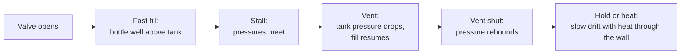
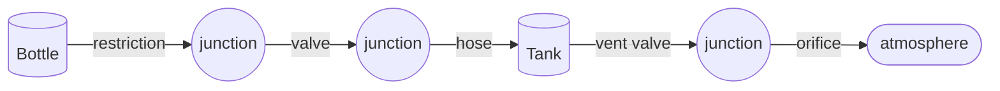

# Model

This page explains what the simulator computes and why, how far it has been checked against real
fills, and what it leaves out. Read the first part to understand what you are looking at in the
window. Read the rest before you rely on a number.

- [Overview](#overview): a fill, start to finish, in plain terms
- Sections 1 to 5: how the simulator represents it
- Section 6: limitations
- Sections 7 and 8: how it compares with four test logs, and what is still open
- Section 9: property data for planning a fill
- Section 10: sources

The code works in SI units with absolute pressures. Gauge pressures in the window and in scene
files are relative to the `P_atm_kPa` setting.

## Overview

Nitrous oxide is stored as a liquid under its own vapour pressure. That one fact explains most of
what a fill does.

Pressure is temperature. A bottle or tank holding liquid and vapour together sits at the
vapour pressure of its liquid: about 718 psig at 20 °C, 900 psig at 30 °C. You do not set the
pressure of such a vessel; you set its temperature and the pressure follows. Warm the liquid and
pressure rises by 14 to 21 psi per kelvin. Let some boil off and it cools and the pressure falls.

A fill is driven by a temperature difference. Liquid flows from the bottle to the tank only
while the bottle is at a higher pressure, which means while it is warmer. As it delivers, the
bottle cools (its liquid boils to fill the space left behind) and the tank warms (vapour is
compressed and condenses). The two pressures meet and the flow stalls, usually well before the
tank is full.

Liquid flashes on the way in. Saturated liquid dropping to a lower pressure cannot stay
liquid: part of it boils at once. From a 30 °C bottle into a 550 psig tank, 29 % of the mass
arrives as vapour. That vapour takes up room and has to be vented if the fill is to continue.

Venting buys flow by throwing nitrous away. Opening the vent drops the tank pressure, the
liquid surface boils and cools, and the fill resumes. Shut the vent and the pressure rebounds
within a minute as the cooled surface warms from the liquid below. Every kelvin of cooling costs
one to eight percent of the liquid, more the warmer it is.

Heat arrives slowly and from several directions. The tank wall, the sun, the air and a heater
all move heat in or out on a time scale of minutes. That is what makes a sealed tank's pressure
drift, and what a heater uses to raise it.

A fill replayed in the window shows all of this as a sequence:



The simulator is a small set of equations for exactly these effects: the state of each vessel, a
law for flow through each restriction, and heat exchange between liquid, vapour, wall and
surroundings. It is a lumped model. Each tank is a few numbers (masses and temperatures), not a
field, and the lines between vessels hold no fluid at all.

## 1. Structure

A scene is a drawing of vessels and the parts that connect them. It compiles to a network, in the
way a circuit drawing compiles to nodes and components.



| Element | What it does |
|---|---|
| Vessels (Bottle, Tank) | Hold the nitrous and carry all the state: masses, temperatures, wall temperature. |
| Flow parts (Pipe, Valve, Orifice, Regulator, CheckValve, ReliefValve) | Each gives a mass flow from the pressure at its two ends and the enthalpy of whatever is upstream. They hold no fluid. |
| Junctions (where wires meet without a vessel) | Hold no fluid either. Their pressure is whatever makes inflow equal outflow. |
| Atmosphere | A fixed pressure. Mass and enthalpy sent to it are totalled. |

### Junction pressures

Between two vessels there may be several parts in a row: a restriction, a valve, a hose. The
pressure at each joint between them is not a state. It is found, every time the equations are
evaluated, as the pressure at which what flows into the joint equals what flows out. A circuit
simulator finds node voltages the same way.

Enthalpy travels with the flow and streams that meet at a junction mix. So liquid that flashes
across a regulator, or along a hose, shows up downstream as a two-phase stream without any special
handling.

Two details make this dependable in practice:

- Dead ends are removed first. A junction with only one open path cannot pass flow, so it
  takes the pressure of what it hangs off and the part leading to it carries exactly zero. With
  every valve shut there is nothing to solve. Where the part leading to a dead end shuts on the
  dead end's own pressure, it stops earlier: behind a shut valve a regulator's outlet rests at
  min(supply, set-point) and never falls with the supply; a check valve stops one cracking
  pressure short; a relief valve reseats at its set pressure.
- Parts that open on pressure are planned in rounds. Regulators, check valves and relief
  valves open and shut on the pressures being solved for. After each solve the plan is checked,
  and a part that was planned as shut and turns out open sends the solve round again with that
  part in. A part found open this way stays in for the rest of that solve. Without that rule two
  check valves in series, or regulators in series, could flip each other shut in turn until the
  rounds ran out, leaving no flow and the full supply pressure across open parts. With the set
  only growing, the rounds end after at most one per pressure-operated part.
- The solve is Newton's method. It works to a mass imbalance of 1e-9 of the largest flow. It
  also stops once no pressure moves by more than 0.01 Pa, because the flow laws carry round-off
  of their own (largest with supercritical fluid upstream); an imbalance under 1e-6 of the
  largest flow is then accepted. A junction that is in balance and that no flow responds to is
  held where it is while the others are solved; left in, its empty row would make the whole
  system singular.
- Two rules keep Newton from cycling. No pressure moves more than 20 bar in a step, and a
  step is halved (twice at most, and up to five times once a solve is past its twelfth
  iteration) if the imbalance does not fall. And a step may not jump a
  pressure-operated part's band. Outside its band (shut, or fully open) such a part's area does
  not answer the pressures, so the Jacobian knows nothing of the band ahead, which is 30 psi
  wide for a default regulator and 0.3 psi for a default check valve. A step that would carry a
  part from outside its band past the middle of it is cut to stop at the middle; the next step
  has the part's real slope. Circuit simulators limit the voltage step across a diode for the
  same reason. A regulator or relief valve also passes nothing backwards, which is one more
  such corner: a step that would reverse the pressure across one is cut to close nine tenths of
  it instead.
- Slopes are taken on the part's own side of a corner. The Jacobian comes from differencing
  each part's flow with a step of a millionth of the pressure. For a pressure-operated part
  within that step of the edge of its band (a check valve passing milligrams a second) the
  step is taken away from the edge; across it the slope comes out many times too small. Flow
  reversing through any part is a corner of the same kind, since what comes back is the fluid
  from the other end; a solve past its twelfth iteration treats it so.
- A fallback handles what is left. If Newton does not settle (a restriction starting to
  choke; the top of the two-phase dome, where the flux through a restriction turns from falling
  to rising as its upstream pressure climbs), each junction is balanced in turn with its
  neighbours held. That cannot fail, since a junction's imbalance falls steadily as its own
  pressure rises, but it closes in slowly along pipes in series. Its use is to get off the
  corner: Newton is tried again after eight passes, and once more after sixty further passes.
- Every solve has an allowance of 600 part-flow evaluations for each part carrying flow. A
  normal solve takes 4 a part, and the costliest that converged in 450 random plumbings took 428. A
  solve that spends its allowance stops at the pressures that came closest to balance. Most of
  what cannot be solved is not physical: a stage of a step the ODE solver is about to reject can
  ask for the flows at 1e15 Pa, and without the allowance each such stage ran every method above
  to its end, about a hundred times the cost of a solve that works. A state that is not a number
  is not solved at all. Nothing a failed solve leaves behind (starting pressures, junction
  enthalpies, the factorised Jacobian) is carried into the next.
- A solve that fails is counted, and the window shows the count in amber. It is not
  harmless: the flows it leaves do not balance, so mass goes missing between vessels. A solve
  that ends with a part open, more than 3 kPa across it and no flow through it is counted as
  failed too, whatever its imbalance: zero flow everywhere balances every junction, and a line
  that has merely stopped must not pass for one that has converged.
- A junction nothing flows into has no enthalpy of its own. It holds no fluid. While a solve
  is still moving the pressures about, what leaves such a junction is taken to be what its
  highest-pressure neighbour would send. (It used to keep its last mixture. One evaluation at
  a state far from anything physical could then leave an enthalpy the flow law returns nothing
  for, and the line stayed shut behind it.) A state with a vessel above 1e9 Pa is not solved
  at all: the derivative is returned as not a number and the ODE solver shortens the step.

### Time stepping

The vessel states are integrated with a stiff ODE solver (Rodas5P, adaptive step). Valve strokes,
scheduled actions and switches between vessel modes happen between steps.

The solver chooses its own step: milliseconds while a valve opens, seconds when nothing is
changing. It is allowed to run ahead of the time on screen, and what is shown and recorded is
read off its interpolant. When you click a valve the solver is first wound back to the displayed
time, so the click takes effect exactly then. Forcing a step to end on every screen frame instead
would cost 60 steps per simulated second and make the window lag.

<details>
<summary>How the Jacobian is built (for anyone changing the solver)</summary>

The solver needs the Jacobian of the right-hand side at every step. Each vessel's own equations
are differenced, one column per state. The junction solve is not repeated for each column. A
change in a vessel's state reaches the rest of the system only through that vessel's pressure and
the enthalpy at its ports, and to first order the junctions answer those linearly. So once per
Jacobian the network is linearised about the solution just found: each part's flow is differenced
with respect to the pressure at each end and the enthalpy arriving from upstream, and the mass
balance and mixture enthalpy of every junction are written out to first order and factorised.
Each column is then one evaluation of the perturbed vessel, a back-substitution for the change in
every flow and junction enthalpy, and the vessels' derivatives with those flows.

A wall temperature changes neither the vessel's pressure nor what leaves through its ports, and a
vessel with every connection shut has no flow to change: those columns need only that vessel's
derivative. If the junction solve gave up, the network is linearised all the same, about the
pressures the solve stopped at. The slopes of the flow laws exist there whatever the imbalance:
with solves cut short on purpose and up to four tenths of the flow out of balance, the result
stayed within about 1e-2 of the converged Jacobian (largest entry of each row). Differencing
through the whole right-hand side there costs a failing solve for every state and returns the
difference of two unconverged results over a step of 1e-7: errors of 1e6 and more on the same
scale.

On the HF4 replay a Jacobian costs 42 to 54 part-flow evaluations this way, against 250 to 520
for plain differences. The two agree to about 3e-4 of the largest entry in each row, and plain
differences are themselves no closer than that to a central difference.

</details>

### Balances and recording

A running total of mass and energy (vessel contents + wall heat + vented − heat taken in) is kept
and shown. It should stay at zero; in the tests it holds to about 1e-6 for mass and 1e-5 for
energy. If it drifts, something is wrong.

A run records, at up to ten samples a second, every vessel and junction state, every flow, each
valve's position and command, heater states, set-points and the ambient conditions, plus a
timestamped log of every action applied. The README lists the exported columns.
A Gauge or LoadCell whose sensor parameters are set also records what the instrument would have
reported (`NAME.P_read`, `NAME.T_read`, `NAME.m_read`; see section 8).

A valve has four signals. `position` is how far open it is, 0 to 1. `cmd_frac` is how far open it
is being told to be: 0 or 1 for a valve commanded shut or open, the fraction for one set
part-open. `open_cmd` is 1 whenever `cmd_frac` is above zero, which is what a 0/1 valve column in
a test log means. `stuck` is 0 for a healthy valve, 1 stuck open, 2 stuck closed and 3 stuck
part-way; while it is not 0, `position` does not follow the command.

## 2. Nitrous oxide properties (`src/n2o.jl`)

Everything else rests on the fluid's properties, so they are computed from a reference equation of
state and not from fitted curves.

| What | Source | Notes |
|---|---|---|
| Density, energy, enthalpy, entropy, pressure | Lemmon & Span (2006), the short Helmholtz-energy form used by REFPROP and CoolProp, implemented directly | Coefficients copied from CoolProp's `NitrousOxide.json` |
| Saturation line | Solved from the equation of state at load (equal pressure and Gibbs energy), tabulated up to 309.40 K | Above that the fluid is treated as single-phase |
| Viscosity, thermal conductivity | ESDU 91022 (1991), saturated liquid and vapour | Outside ESDU's ranges (viscosity −90 to 30 °C, conductivity −90 to 10 °C) the nearest in-range value is used |

- A state is found from (ρ, u), (P, h) or (P, s) by Newton's method. Inside the two-phase dome it
  is an equilibrium mixture of saturated liquid and vapour.
- The saturation table has 2048 rows and is read as a cubic with fourth-order slopes, which
  reproduces the equation of state to about 1e-11. That accuracy matters for a practical reason:
  where an expansion enters the dome the table takes over from the equation of state, and any
  mismatch there is a step in the flow that the junction solve can cycle around. A 512-row table,
  good to 1e-7 inside and 1e-4 at its ends, does exactly that.
- The tests check the properties against CoolProp (saturation line to 1e-5 or better,
  single-phase states to 1e-8) and against the tables in section 9.
- ESDU flags most of its own transport values as not backed by measurement. They enter only
  through heat-transfer coefficients and pipe Reynolds numbers.
- There is no solid phase. Below the triple point (−90.8 °C) temperature is clamped.

## 3. Flow through a restriction (`src/flow.jl`)

Every flow part is an effective area times one function: the mass flux G for a given upstream
state and downstream pressure.

### Flashing flow

Cold liquid through an orifice follows the textbook law: flux proportional to the square root of
the pressure drop. Saturated liquid does not, because it starts to boil as the pressure falls
through the restriction. Two limits bracket what happens:

- With no time to boil, the liquid passes through still liquid (single-phase incompressible, SPI):
  $G_{SPI} = \sqrt{2\rho_1 (P_1 - P_2)}$. This overestimates the flow of a liquid close to boiling.
- If it boils instantly and fully, liquid and vapour stay in equilibrium along the expansion
  (homogeneous equilibrium, HEM): $G_{HEM} = \rho_2 \sqrt{2(h_1 - h_2)}$ along the isentrope. The
  vapour that forms chokes the flow, so past a certain pressure drop the flux stops rising. This
  underestimates the flow through a short restriction.

Real flow sits between them, nearer SPI when the liquid is well below its boiling point and nearer
HEM when it is at it. The model blends the two by how close the liquid is to boiling.

### Flux law

| Upstream | Law |
|---|---|
| Liquid or two-phase | Dyer's blend as written in Zimmerman et al. (2013), eq. 7: $G = (\kappa\,G_{SPI} + G_{HEM})/(1 + \kappa)$ with $\kappa = \sqrt{(P_1 - P_2)/(P_{sat}(T_1) - P_2)}$. Subcooled liquid discharging above its vapour pressure is pure $G_{SPI}$. With vapour already present upstream the result is faded towards $G_{HEM}$ by quality. |
| Vapour or supercritical | $G_{HEM}$ alone: real-gas isentropic nozzle flow, choked when the back pressure is low enough. |

- Choking is found by searching for the maximum of $G_{HEM}$ along the expansion. Inside the
  dome the search runs along the saturation table. Coming from single phase, the point where the
  expansion enters the dome is evaluated directly, because the speed of sound drops there and the
  flux often peaks exactly at it; the single-phase stretch above is searched only if the flow is
  already supersonic at that point.
- Near the critical point the $G_{SPI}$ share is faded out linearly over the last 2 K below
  the critical temperature, so that the two rows of the table meet. This is a numerical choice,
  not a measured one: liquid and vapour become one fluid there, and without the fade the flux
  stepped by about 15 % where a supercritical supply crossed into the two-phase region. Nothing
  below 34.2 °C is affected.
- Supercritical supply (a bottle left in the sun past 36.4 °C) runs but is unvalidated and
  slow. Every flux evaluation there needs iterative property solves in place of table look-ups
  (51 µs against 3.6 µs for saturated liquid at 25 °C), and the window can hitch for up to a
  second when such a bottle is opened into an empty tank.

### Effective areas

| Part | Effective area |
|---|---|
| Orifice, Valve | `Cd·π·d²/4`. A valve may give `Cv` instead (1.698e-5 m² per unit Cv), and its area scales with how far open it is: the larger of its opening and its `leak_frac`. |
| Pipe | area × (1 + K + f·L/D)^-½ with the Churchill friction factor. Below Re = 4000 the value at 4000 is used (section 6). |
| Regulator | area × clamp((set − P_outlet)/droop, 0, 1), flow a → b only |
| Relief valve | area × clamp((P_inlet − set)/band, 0, 1), flow a → b only. The band is `band_frac` × set pressure (gauge) + 500 Pa: with the default 0.1, fully open 10 % above the set pressure. |
| Check valve | opens over a band above its cracking pressure |

`Cd` is the calibration knob on every part. Typical sharp-edged values are 0.6 to 0.8.

A valve's opening is a share of its area, not a stem position: a valve set to 0.25 passes a
quarter of what it passes fully open at the same pressures, whatever its trim. It moves towards
the opening it is told at 1/`travel_s` of full stroke a second, so a `set` from shut to 0.25
takes a quarter of the stroke time. `leak_frac` is the share of the area that still passes when
the valve is shut, and it is the whole effect of a leak: at any opening above it the valve
passes what a tight one would.

## 4. Bottles and tanks (`src/vessel.jl`)

A vessel is modelled as three things that can be at different temperatures, plus air:

```
        vent port
     ┌─────┴─────┐
     │  ullage   │◄── wall (dry part) ◄── sun, wind, infrared
     │  vapour   │
     │  + air    │
     ├~~~~~~~~~~~┤  surface: saturated at the N2O pressure
     │           │
     │  liquid   │◄── wall (wetted part) ◄── heater
     │           │
     └─────┬─────┘
        fill port
```

Keeping liquid, vapour and wall separate is what lets the model show a vent pulse cooling the
surface and the pressure rebounding afterwards. A tank with a single temperature cannot do that.

### Stratified mode

This is the normal mode. The states are liquid mass and temperature, ullage N2O mass and
temperature, wall temperature and air mass. The formulation follows Zilliac & Karabeyoglu (2005)
as set out in Zimmerman et al. (2013).

- Liquid has the density and energy of saturated liquid at its own temperature.
- Ullage is real gas, which may be superheated or slightly supersaturated. Tank pressure is
  the ullage N2O pressure plus the partial pressure of any air.
- The surface between them is saturated at the N2O partial pressure. Heat reaches it from the
  liquid and leaves it to the ullage; evaporation is the net heat arriving divided by the latent
  heat.
- Geometry is an upright cylinder of the given volume and diameter. A port draws liquid or
  ullage according to its height: fully liquid once the level is 1 cm above it.

Each path that moves heat or mass has its own law and, where the law is uncertain, a knob:

| Path | Law | Knob |
|---|---|---|
| Liquid ↔ surface | Natural convection, Nu = 0.15·Ra^⅓. When the liquid is hotter than the surface (it wants to boil) the coefficient is multiplied by a large factor. | `interphase_E`, default 700. The literature reports fitted values from 240 to 1300 and no way to predict it. |
| Surface ↔ ullage | Natural convection, same form | none |
| Ullage that is denser than saturated vapour | Condenses with a time constant; the condensate joins the liquid | `cond_tau_s` |
| Wall ↔ liquid and wall ↔ ullage | Natural convection, Nu = 0.021·Ra^0.4, over the wetted and dry areas | `h_in_mult` |
| Wall ↔ surroundings | Natural convection (0.59·Ra^¼) combined with wind over a cylinder (Hilpert); absorbed sunlight on the projected area; infrared exchange with ambient; heater power | `h_ext_mult`, `absorptivity`, `emissivity`, `shade`, `heater_W` |
| Inflow below the liquid level | Joins the liquid with all its enthalpy. Flash vapour bubbling up heats the liquid; if that leaves it superheated it boils at the surface. | none |
| Inflow above the liquid level | Flashed at tank pressure and split between liquid and ullage | none |

Air in the ullage is a second, ideal gas with its own mass, heat capacity and partial pressure. It
leaves with vented ullage gas. Section 6 gives the limits of this.

### Optional wall model

One wall temperature cannot be right for a thin tube with heavy end caps: the tube follows the
contents in seconds while the bulkheads lag for minutes. Three options address that. All are off
by default, and with all three off the equations and results are exactly those above.

| Option | What it adds |
|---|---|
| `wall_split = 1` | Two wall temperatures. The tube (a share `wall_tube_frac` of the wall mass) exchanges heat with the liquid over its wetted part and with the ullage over its dry part, and takes the sun and the heater. The ends take the bottom to the liquid and the top to the ullage. `wall_link_W_K` conducts between tube and ends. `wall_ends_W_K`, if set, puts a conduction path in series with the ends' contact with the contents: a thick bulkhead gives up its heat only as fast as the metal conducts it to the wetted face. |
| `h_fill_mult` | Stirring of the liquid by the incoming jet, added to the wall-to-liquid coefficient (Dittus-Boelter on the tank diameter with the jet velocity decayed as 6·d/D, combined with natural convection as the cube root of the sum of cubes). |
| `h_boil_mult` | Boiling on a wetted wall hotter than saturation. |

The boiling flux is the pool-boiling data of Gorenflo and Kotthoff (2005) for carbon dioxide, as
Zimmerman (2015, eqs 5.76-5.77) fitted it for tank models, carried over to nitrous oxide by
reduced pressure $P_r$:

$$\ln h_{20} = 0.3092\,(\ln P_r)^3 + 1.649\,(\ln P_r)^2 + 3.641\,\ln P_r + 5.272, \qquad h \propto q^{\,n},\; n = 1 - 0.3\,P_r^{0.3}$$

with $h_{20}$ in kW/m²K at 20 kW/m². The flux rises about as ΔT⁴, so a wetted wall cannot stay
more than a kelvin or two above saturation. It is capped at Zuber's critical heat flux; drying
out beyond that is not modelled. The data stop at $P_r$ = 0.625 (about 14 °C for nitrous), so warm
tanks are an extrapolation, which is why there is a multiplier.

These options exist because thermistors on a tank wall were seen within about 1 K of the liquid
through a long hold, and falling 28 K within seconds of a fill starting, where a single wall
temperature sits several kelvin above the liquid. Section 7 says what the test logs do and do not
determine about them.

### Heater control

A heater delivers `heater_W` to the wall (to the tube, with `wall_split`) while it is switched
on. `heater_ctl` says what, if anything, runs it in that time:

| `heater_ctl` | Behaviour |
|---|---|
| 0 (default) | Full power while switched on. The equations and results are exactly those without a controller. |
| 1 | Holds the vessel's pressure at `heater_set` psig. |
| 2 | Holds the wall temperature at `heater_set` °C (the tube's, with `wall_split`). |

The controller is proportional. With $x$ the pressure or wall temperature, $x_s$ the set-point and
$b$ the band `heater_band` (psi or K):

$$Q = Q_{max}\,\varphi^2(3 - 2\varphi), \qquad \varphi = \mathrm{clamp}\!\left(\frac{x_s - x}{b},\, 0,\, 1\right)$$

Power is full a band or more below the set-point, zero at and above it, and follows a smooth
S-curve between. There is no threshold at which it switches, so it cannot chatter, and the
solver sees no step. The vessel comes to rest inside the band, at the point where the power
equals what it loses to its surroundings: below the set-point by a share of the band that grows
with the losses. A controller acts only while the heater is switched on, and it can only heat: a
tank the sun takes past the set-point stays there.

The default band is 10 (psi or K). It was chosen for pressure control. The heater warms the wall
and the wall warms the liquid, so when the power comes off there is still heat in the wall on its
way in. A sealed 19 L tank holding 8 kg under 300 W in 10 °C air climbs to its resting
pressure and falls back from its peak by 0.04 psi with a 10 psi band, by 0.4 psi with 5 psi, and
by 0.6 psi with a few decaying swings with 2 psi, never reaching the set-point. A 40 L steel
bottle, whose wall holds more heat, falls back 0.25 psi with 10 psi and 0.7 psi with 5 psi.
Ten psi is about half a
kelvin of saturation temperature. Wall-temperature control acts on the state it heats and does
not overshoot at any band, so 1 to 2 K is a reasonable setting there.

The power delivered is recorded as the signal `<vessel>.heater_power`, in watts.

### Homogeneous mode

One mixed volume at (m, U) with the full equation of state. A vessel switches to it when ullage
falls below 0.5 % of the volume, or the liquid passes 35.3 °C, and switches back when a real
ullage reappears. Mass and energy carry over exactly. This is what makes an overfilled tank
warming up show a steep pressure rise and lift its relief valve, where a two-zone model would
simply fail.

## 5. Warm-soak check

The run panel shows, for the mass now in each tank, the pressure and liquid fraction if the tank
were closed and brought to 30 °C and 35 °C. It answers "what if this sits in the sun with the
vent shut?". It is a property calculation on (mass, volume, temperature), independent of the
dynamic model, and it reproduces the liquid-full thresholds in section 9.

## 6. Limitations

Each of these is a deliberate limit. The first is the one most likely to matter.

- The lines hold no fluid. Giving every junction a volume and a fluid state would show a hose
  charging and liquid trapped between closed valves, but it could not be solved reliably: a few
  millilitres of nearly incompressible liquid on the edge of boiling make the equations so stiff
  and kinked that every solver tried took microsecond steps or stalled. So there is no
  hose-charging transient; the slug of liquid in a pre-charged hose does not arrive at the start
  of a fill; no heat is picked up in the hose; and an isolated section of line just holds its
  last pressure. In HF4 the hose was charged before the tank valve opened and the model is about
  100 psi low for the first 10 to 20 s. In HF3 the hose was not pre-charged and the first 20 s
  agree to 27 psi, which fits that explanation without proving it. A small Tank teed onto the
  fill line was tried as a stand-in for the hose's volume and is not recommended: it behaves as a
  gas cushion, softens the start of any fill whether or not the hose was pre-charged, and did not
  improve held-out logs. To study liquid trapped between two shut valves, put a small Tank where
  the trapped volume is; there is a test doing exactly that.
- The liquid has a single temperature, with no warm layer at the surface. Vent rebound comes only
  from the lag between liquid and ullage. Section 7 has evidence that this matters in a long hold.
- Boiling swell is not modelled. In a real tank, bubbles formed in the liquid while venting raise the
  level for as long as it boils, and can put liquid at a dip tube before the settled level gets
  there. Here the level is always the settled level, so "liquid %" can fall during a vent (the
  liquid boils off and contracts as it cools, about 1 % in volume per kelvin near 23 °C) and
  liquid reaches the vent later than it would in practice.
- Air is a second gas in the ullage only. It has its own heat capacity and partial pressure,
  and leaves with the ullage gas in proportion to how much of the gas it is. Once in the lines the
  stream is counted as N2O: the lines carry one fluid, sized by the flow law as if it were N2O
  vapour at the same pressure and temperature, which overstates the mass flow of nearly pure air
  by about a fifth. Anything that flows back in from the atmosphere arrives as N2O. A tank's worth
  of air is tens of grams, so this matters only until the first N2O has displaced it.
- Each vessel has one wall temperature (two with `wall_split`), and there is no conduction into stands and
  plumbing.
- The heater controller is an idealisation. It is proportional and has no delay. A real
  thermostat that switches fully on and off around its set-point gives the same average power but
  a ripple this one does not show. The heater has no heat capacity of its own, and its power goes
  to the wall as a whole, wherever on the tank it sits.
- There is no nitrogen, either as a pressurant or dissolved: the contents are pure N2O plus
  inert air.
- Hydrostatic head and elevation differences are ignored (about 1 psi per metre of liquid).
- Flow near zero pressure difference is smoothed within about 300 Pa so that it passes through
  zero with a finite slope; the true √ΔP law has infinite slope there.
- Laminar pipe flow is not modelled (the friction factor is held below Re = 4000). It matters
  only for trickles of a gram per second or less.
- Pipe friction is an equivalent orifice, which is rough for a long line that flashes along
  its length.
- The relief valve has no pop and reseat hysteresis.
- A leak into a closed section of line fills it at once. The lines hold no fluid, so the
  section between a leaking valve and a tight one has nothing to fill: it stands at the
  pressure beyond the leak from the first evaluation, with no flow through the leak. A real
  section comes up over the time the leak takes to fill it. To see that time, put a small Tank
  where the section is, as for trapped liquid. A leak that leads on to a vessel or to the
  atmosphere flows at its own rate.
- Trickles mix badly. A junction's mixture enthalpy follows the flows into it, and the
  junction solve's Jacobian leaves that out. It matters where a trickle of vapour meets a
  trickle of liquid (a leak beside a check valve that is just cracking, near atmospheric
  pressure): a few percent of vapour by mass changes the mixture's density several times over,
  and with it the flow through the next part. Such solves converge slowly and now and then not
  at all.
- A valve's opening is a share of its area. There is no trim characteristic (linear, equal
  percentage, quick opening) between stem travel and area, and the discharge coefficient does
  not change with opening.
- Vessels at rest against each other sit on a corner. Two vessels joined by an open line
  and long equalised breathe milligrams a second back and forth as they warm and cool, and what
  flows depends on which way: liquid from a bottle's dip tube one way, vapour from the tank the
  other. The equations have a corner exactly at the resting state. The ODE solver rejects more
  steps there, and a rejected step can pass through states far from anything physical (1e15 Pa,
  or not a number). Those are cut short by the junction solve's allowance and can show in the
  count of failed solves, though no accepted step used them.

## 7. Calibration

This section and the next say how far to trust the model. The summary first:

| Question | Answer |
|---|---|
| Does it have the right structure? | Yes. Bottle cooling sets the stall, the vent sets a floor near the liquid's vapour pressure, and heat through the wall sets the slow drift. All three appear in the right place and order on every log. |
| How close is tank pressure? | 3 to 8 psi RMS through stalls, holds and heating; 15 to 60 psi through the fast part of a fill. |
| How close is loaded mass? | Within about 0.5 kg of the load cell at the end of a fill, on the three tests that have one. Part-way through the HF4 fill the two differ by 1.6 kg (see below). |
| Which values are measured or well determined? | Bottle temperature, tank wall mass, the weather, the fill-line restriction. |
| Which are not? | The boiling factor `interphase_E`, the wall and outside heat-transfer multipliers, the vent coefficient on the test stand. They are published values, not calibrated ones. |
| Is it validated? | No. It has been fitted to one fill and compared with three more. |

### HF4

HF4 was a static hot fire on 2026-07-11. `scenes/hf4.toml` is the fill panel and tank as drawn
in the QRET Chimera Final Design Report (2026), Fig. 35. The logged valve and heater states
(`test/data/hf4_fill_10hz.csv`, a 10 Hz slice of the hot-fire log) drive the model from device
time 9020 s to 10010 s. Values fitted, in the order they were pinned down:

| Parameter | Value | Pinned by |
|---|---|---|
| Bottle temperature | 32.2 °C | PT201 before the fill (934-952 psig) |
| Bottle contents / volume | 20 kg / 40 L | how far bottle pressure falls as it delivers (stall pressure) |
| Restriction bottle → panel | 2.5 mm at Cd 0.7 | fill rate; the procedure lists a 1/4" hose with a CGA 326 nipple here |
| `h_in_mult` | 0.3 | vent drop and rebound, and the heater slope |
| Heater | 300 W | heater period, 775 → 843 psig in 469 s |

Left at defaults or guesses at the time: `interphase_E` (HF4 does not constrain it: 100 to 2000
changes the result by a few psi), vent `Cd` 0.7, tank wall 10 kg, ambient 28 °C, sun 600 W/m².
The scene has since been given the measured wall mass, weather and bottle temperature
(see [Open findings](#open-findings)); the numbers below are from the fit as it was made, and
move by a few psi with those inputs.

Tank pressure, model against PT202 (RMS over each period):

| Period (device s) | What happens | RMS error |
|---|---|---|
| 9084-9104 | first 20 s of fill | 109 psi (probably the pre-charged hose; see section 6) |
| 9104-9160 | rest of the fast fill | 28 psi |
| 9160-9256 | stall | 5 psi |
| 9256-9330 | vent 1 and rebound | 16 psi (model drops to 723, log to 697) |
| 9330-9372 | vent 2 and close | 8 psi |
| 9387-9856 | heater | 3 psi |
| PT201, 9100-10000 | bottle side | 9 psi |

Mass: 9.5 kg at the end of fill; the load cell, tared with the hose charged, reads 9.5 kg at fill
close and 9.8 kg before firing. One discrepancy is open: at the stall the model has 8.3 kg where the
load cell reads 6.7 kg. Section 8 gives a reason to doubt the load cell there, but it is a
hypothesis; if the load cell is right, the model overstates how much goes in before the first
vent.

This is a fit to one fill with five adjusted numbers. It shows the model has the right structure.
It is not a validation.

### HF3

HF3 (2026-06-07) was a different procedure on the same hardware: AV-203 open first, then one
unvented fill through AV-201 for 288 s, bottle at 849 psig. The HF4 scene was run against it with
nothing re-fitted. Only the bottle's starting pressure (measured) and the ambient temperature
(22 °C, a guess; the log has no temperature) were changed. `test/data/hf3_fill_10hz.csv`.

| Period (device s) | What happens | RMS error, tank pressure |
|---|---|---|
| 4528-4548 | first 20 s | 27 psi |
| 4548-4620 | fast fill | 53 psi (model reaches the stall about 20 s early) |
| 4620-4814 | stall | 6 psi (model 722-725 psig, log 711-723) |

Final load 9.0 kg against a load cell reading of 9.3 kg that includes roughly 0.6 kg of hose load.
So the stall pressure and the load carried over to a different day and bottle state. The fill
rate in the middle of the fill is too high in both tests and is the model's clearest error.
Moving the guessed ambient temperature by ±6 °C moves the final load by about ±0.5 kg, so that
guess matters. After the fill, HF3's log shows the run heater switched on for 150 s while tank
pressure fell about 5 psi; the model with HF4's 300 W rises 20 psi. The log records that the
heater was switched on, not what it delivered.

### Performance

The 990 s HF4 replay takes about 0.3 s (559 solver steps, about 230,000 equation-of-state
evaluations). In the window at ×1 the solver uses a few hundredths of a millisecond of a typical
frame and 3.5 ms in the worst single step. `test/stress.jl -d` drives scenes nobody tuned (a bottle
heated until supercritical, and 150 random plumbings from default parts, valves opened, set
part-open and toggled, a quarter of them leaking). No junction solve fails in either. The
costliest single solver step in them takes 12,100 part-flow evaluations, about 32 times HF4's
average step: a step the ODE solver attempts several times over, with junction solves that
converge slowly at a corner of a flow law. The next 300 plumbings have three failed solves and a
step of 29,000: a leak of a millionth of a valve's area feeding a check valve at its cracking
pressure, where every solve converges but takes some 170 evaluations a part.

The cost of a step is bounded in part. One junction solve spends at most 600 evaluations for each
part carrying flow (section 1), and one attempt at a step is nine solves and a Jacobian. The
number of attempts the ODE solver makes at a step before it accepts one is not bounded; the most
seen is nine.
`test/bench.jl` prints the HF4 numbers.

### HF3 cold flow and LC26 day 4

Two more logs, replayable with `scenes/hf3cf.toml` and `scenes/lc26_day4.toml` (data in
`test/data`).

- On the HF3 cold flow (nitrous, unvented fill, 4.3 kg), with the HF4 fit unchanged, tank pressure
  stays through the
  100 s sealed period within 5.1 psi RMS, bottle recovery within about 4 psi, load 4.6 kg against
  4.3 kg on the stand load cell. Post-fill warming is 0.08 psi/s in the model against 0.13 logged.
  Open: the model empties the tank through the injector, while the load cell shows about 2.3 kg
  left at 0 psig.
- HF4 vents prefer a larger vent. Vent `Cd` 0.85 with `interphase_E` 300 takes vent 1 from 16
  to 8 psi RMS (minimum 696 against 696 logged) and vent 2 from 8 to 3, but the heater period from
  3 to 7 psi. Final load 9.7 kg. The scenes keep the published values.
- LC26 day 4 has tank temperatures. The two heater thermistors sit within about 1 K of the
  saturation temperature of PT202 through the 1000 s sealed hold, and 1 to 2 K above it during the
  vented fill. With `h_in_mult` 0.3 the model's wall runs about 6 K warmer than its liquid after
  the fill. That is the reason for the optional wall model in section 4.
- On LC26 the tower load cell is unusable, so the vent size, fill flow
  and bottle contents trade off. The scene uses vent `Cd` 1.0 and a 28 kg bottle, and follows the
  tank through the hold within 5 psi RMS but the vented fill only within about 33 psi.

### Open findings

These came out of a systematic comparison with all four logs: measured inputs fixed, thousands of
parameter sets sampled, and a joint fit repeated with each log held out in turn. They are stated
here because they limit what the model can be trusted for.

The scenes use measured inputs where they exist. The HF4 and HF3 cold flow scenes carry the test days' weather from a
historical archive (air temperature good to about 2 °C, sun, wind reduced from 10 m to stand
height by estimate), the tank wall mass from the vehicle mass budget (9.06 kg: tube 7.18 kg,
bulkheads 0.88 and 1.00 kg) and bottle start temperatures from the bottle-side pressure before
the fill. Tank start temperature on the stand was not measured and is set to ambient.

The logs determine some values and not others. A joint fit of sixteen values to all four
logs, with the measured inputs fixed, a bare-aluminium tank surface (absorptivity 0.3, emissivity
0.1) and the two-node wall switched on, brings every log to about one tolerance in the scoring of
[STUDIES.md](STUDIES.md) (30 s bins, load-cell changes, a stated allowance for the first 20 s of a
fill). Repeating it with each log held out shows which values are properties of the hardware:

| Value | Range over the five fits | |
|---|---|---|
| Fill-line bore, stand tests | 2.10-2.24 mm | steady; agrees with the load cell |
| Fill-line bore, LC26 | 2.07-2.34 mm | steady |
| Outside heat multiplier | 2.7-5.3 | always well above 1 |
| Vent `Cd`, LC26 | 0.73-0.86 | fairly steady |
| Restriction after the bottle-side gauge | 4.7-9.5 mm | not determined |
| Tank wall coefficient | 0.74-10 | not determined |
| Wall boiling multiplier | 0.26-1.44 | not determined |
| Vent `Cd`, stand tests | 0.5-1.2 | not determined |

The fit improved two of the four held-out logs and worsened the other two, so its values are not
in the scenes. `interphase_E` matters only around vents, and there the logs disagree: between 200
and 2000 the error over HF4's first vent goes from 15 to 30 psi, preferring the low end, while the
pressure at which LC26 day 4's vent shuts and the 30 s recovery after it prefer the high end. One
shared value fitted freely improves two held-out logs and worsens two. The bottle
wall coefficient has no visible effect at all. What moves a result most is what was not recorded:
how full the bottle was.

The fill line is probably tighter than the scenes say. The load cell's fill rate against the
logged line pressures puts the restriction between bottle and panel at about 2.2 to 2.4 mm bore
(at `Cd` 0.7) on HF3, its cold flow and HF4; the scenes use 2.5 mm. With 2.3 mm the cold flow
loads 4.0 kg and its sealed pressure comes out 36 psi low. Raising wall and outside heat transfer
about tenfold and fourfold restores the three stand logs but makes LC26 day 4, held out, worse. So
the published 2.5 mm and wall coefficient 0.3 agree with the stand logs partly by compensating
each other, and the scenes keep them until the tank's heat balance during a fill is understood.

A sealed tank warms faster than the model allows. Through the 1000 s hold of LC26 day 4 the
saturation temperature of the tank pressure rises 0.8 K/min at 2 °C, falling to 0.4 K/min at
10 °C. For the whole contents and wall to warm at that rate takes 250 to 500 W. A bare aluminium
tube of this size in that day's weather (about 20 °C, 600 W/m² of sun, 2 to 3 m/s of wind) takes
in roughly 120 to 240 W: about half, steadily through the hold. Either twice the heat reaches the
tank, or only about half of its heat capacity is warming, as it would if the liquid were layered
with the warm part on top.

The second reading is the likelier one. Two limiting cases need no fitted number. If everything
warms together, the hold's pressure rise (437 to 584 psig in 1060 s) takes 310 to 380 W for 8 to
12 kg loaded. If all the heat evaporates liquid at the surface and the liquid below does not
change, it takes 50 to 80 W. The heat available lies between the two, so no extra heat is needed
if the bulk liquid takes only part. The timescales agree: in this tank heat needs about an hour to
travel half a metre along the wall and about 40 minutes to diffuse through a centimetre of still
liquid, and a warm layer on top is stable, so heat entering the upper wall stays near the surface
for the length of a hold. Self-pressurisation tests on cryogenic tanks show the same thing,
with measured rise rates from 1.1 to about 5 times the fully mixed rate depending on where the
heat enters (Aydelott 1967; Van Dresar, Lin and Hasan 1992). The model has one liquid temperature
and cannot represent this, so a fit raises the outside heat transfer in its place: the fits'
outside multiplier of about 3 and the scene's fitted "ambient" of 30 °C for that day both stand
in for a layered liquid and are not heat-transfer results. One hold cannot fix how much of the
liquid takes part; a temperature near the tank bottom during a hold would.

During a fill the tank is not short of heat; the wall gives its heat up late. With wall
boiling near its correlation value the single tube temperature follows the logged skin
temperature to 2 to 3 K. Three changes of structure were tried against LC26 day 4 (boiling past
the peak flux, a wall wetted by the incoming jet, an onset threshold for boiling). None improved
it and none is in the code.

Scoring short valve pulses point by point is unreliable. The HF3 cold flow opens its fill
valve in pulses of about a second, and the bottle-side pressure score over that period moves
between 42 and 55 psi RMS with the solver tolerance alone. Use bins or features there.

## 8. Sensor notes

Two things about the HF4 and HF3 logs matter when comparing the model with them.

The two pressure transducers disagree by about ±5 psi. With the fill valve open and almost no
flow, PT201 (fill panel) reads 3 to 5 psi *above* PT202 (tank) in HF4 and 4 to 7 psi *below* it in
HF3. Flow was into the tank both times, so the HF3 sign is physically impossible: the difference
is sensor mismatch, and it changes between tests. A "stall 3 to 6 psi below the fill line" read
off the HF4 log is therefore inside that mismatch and says nothing about the pressure difference
driving the flow. Before the HF4 fill PT201 read 936 rising to 953 psig, which puts the bottle at
about 33 °C.

The load cell is usable for the end state, not for the fill history:

- Charging the fill hose adds 0.8 kg with nothing in the tank.
- Every vent opening and closing sets it ringing at about 5 Hz with ±2 kg amplitude for several
  seconds. Through the ringing at the first vent opening its mean rises about 1 kg within 0.3 s
  and stays up after the vent closes. Nitrous cannot arrive that fast (the fill was passing under
  0.1 kg/s) and vent thrust would have gone away at closure. The second vent opening and the
  first closing ring the same way with no shift in the mean. One reading of this is that the
  stand was hanging up and the first jolt freed it, in which case readings before that vent,
  including the 6.7 kg at the stall, are about a kilogram low. The log cannot confirm it. HF3's
  load cell, with no vent event, climbs smoothly and agrees with the model.
- With the tank isolated during heating it climbs 0.36 kg with no flow at all.

### Sensor models

A model is compared with what a sensor reported, not with the truth. If the comparison does not
carry an instrument's quirks, a fit bends the physics to absorb them: a transducer reading 5 psi
high becomes a bottle a few tenths of a degree warmer. So a Gauge can be given the instrument's behaviour,
and a LoadCell part reads a vessel's mass the way a load cell under it would.

A Gauge always records the true pressure and temperature of the point it is wired to, `NAME.P`
and `NAME.T`. With any of the parameters below set it also records its reading, `NAME.P_read`
(Pa absolute, like every pressure signal) and `NAME.T_read` (K). At the defaults it records
nothing extra and the reading is the truth. The steps are applied in the order of the table.

| Gauge parameter | Default | What it is for |
|---|---|---|
| `gain` | 1 | Multiplies the gauge pressure: a span error, a mismatch that grows with pressure |
| `offset_psi` | 0 | Added to it: a zero that is off. The ±5 psi between PT201 and PT202 above is this, and its sign changes between tests, so it is a number per test |
| `tau_s` | 0 | First-order lag: a transducer, snubber or filter slower than the transient it is watching (a vent pulse, the first seconds of a fill) |
| `deadband_psi` | 0 | The reading holds until the pressure has moved by more than this: a sticky or coarsely stepped reading |
| `min_psig`, `max_psig` | none | The transducer's range. The reading stops at the limit while the pressure carries on (the defaults, −1e6 and 1e6, are no limit) |
| `T_offset_K` | 0 | Added to the temperature reading |
| `T_tau_s` | 0 | First-order lag on the temperature: a thermocouple or thermistor on the wall or in a well follows the fluid late |

A LoadCell has two pins. `a` is wired to any pin of the Bottle or Tank it weighs; `valve` is
wired to a point that exactly one Valve is on, or left unwired. It records `NAME.m_read` (kg).
Nothing flows through it and it adds no junction: a run with one in the scene is the same
solve, to the last bit, as the run without.

| LoadCell parameter | Default | What it is for |
|---|---|---|
| `offset_kg` | 0 | Added to the vessel's N2O mass: a tare that is off |
| `line_step_kg` | 0 | Added while the valve on the `valve` pin is open at all: the 0.8 kg that charging the fill hose put on the HF4 stand |
| `tau_s` | 0 | First-order lag: the filtering of the load cell's amplifier |

The other load-cell behaviour above is deliberately not modelled. The ringing at valve events
averages out over a time bin (`bin_s`), or those seconds can be left out of the scored phases.
The shift at the first vent and the creep during heating have no known cause to model: score the
channel with `offset = "per_phase"` or state a discrepancy for the phase
([STUDIES.md](STUDIES.md)).

The lag is not a state of the equations. It is advanced each time a sample is recorded, by
the exact solution of τ·y′ = x − y over the interval since the last sample, taking the input `x`
as a straight line between the two samples. That is how the recorded history is read everywhere
else, so a lagged reading is the exact lag of the recorded history and has no step-size error of
its own. For an input that really is straight between samples (a step, a ramp, a quiet hold) the
recording interval changes the reading only by round-off. Otherwise two recording intervals give
readings that differ as their histories of the true value differ, and by less: the lag smooths
the difference. The first seconds of a fill into an air-filled tank are the worst case. There,
recorded every 0.1 s and every 0.5 s, the true pressure histories are up to about 7 psi apart and
a reading lagged by 2 s up to about 3 psi. A valve that moves between two samples reaches a
load cell's `line_step_kg` as a ramp across that interval. Keep the time constant several
recording intervals long, or shorten the interval (`sample_dt` in a study).

In the window a gauge with a sensor model shows its reading, as of the last recorded sample,
and its hover text gives the true values. A gauge without one is unchanged.

## 9. Reference data

Property values are for saturated N2O; gauge pressures use 14.4 psi for the atmosphere. The tests
check these tables against the property code.

A pressure target is a temperature target. A self-pressurising tank sits at the vapour
pressure of its liquid. Reaching a higher pressure means adding heat (HF4: 469 s on the heater to
reach 850 psig); holding a lower one on a warm day means removing heat and keeping it out.

| Tank (psig) | Tsat (°C) | ρ liquid (kg/m³) | ρ vapour (kg/m³) | h_fg (kJ/kg) | cp liquid (kJ/kg·K) | dP/dT (psi/K) | Boil-off to cool 1 K (% of liquid) |
|---|---|---|---|---|---|---|---|
| 550 | 8.8 | 859 | 111 | 208 | 2.52 | 13.7 | 1.21 |
| 700 | 18.9 | 794 | 152 | 174 | 3.09 | 16.3 | 1.77 |
| 850 | 27.4 | 719 | 208 | 135 | 4.54 | 19.0 | 3.37 |
| 950 | 32.4 | 651 | 264 | 99 | 8.36 | 20.9 | 8.45 |

The other way: 0 °C = 438 psig, 10 °C = 566, 20 °C = 718, 25 °C = 805, 30 °C = 900, 35 °C = 1005.
A colder load is denser: the 19.16 L HF4 tank at 90 % liquid by volume holds 15.0 kg at 550 psig
and 12.8 kg at 850 psig.

Saturated liquid from a warm bottle partly flashes on entering a
lower-pressure tank. That vapour has to be vented and is lost.

| Supply liquid | into 550 psig | into 700 psig | into 850 psig |
|---|---|---|---|
| 25 °C (805 psig) | 20.8 % | 10.3 % | no flow |
| 30 °C (900 psig) | 29.2 % | 20.3 % | 7.1 % |
| 33 °C (962 psig, about HF4's bottle) | 35.7 % | 28.1 % | 17.2 % |

Venting to cool the load costs the boil-off column above for every kelvin removed.

Cooling the supply bottle reduces flash loss but also lowers the pressure difference that
drives the fill. Padding the bottle with nitrogen restores it, but nitrogen dissolves in nitrous
and breaks "pressure = vapour pressure of the liquid"; this model has no nitrogen.

An unvented fill stalls at equalisation (HF4: 0.089 kg/s, then 0.008 kg/s for about 107 s).
In a vented fill the vent sets the tank pressure, which settles where vent outflow balances flash
vapour plus displaced ullage; the vent has to carry roughly the flash fraction times the fill
flow. Vent flow and duration are also the icing exposure of the vent valve.

A vent pulse cools the surface, then the pressure rebounds (HF4 vent 1: 803 to 698 psi in
13.8 s, back to about 775 within a minute).

Going liquid-full is the main overfill hazard. A cold, dense load expands as it warms. If the
tank is closed and soaks to ambient, a tank filled too full goes liquid-full, and pressure then
rises hydraulically, far faster than the vapour-pressure curve.

| Filled at | Liquid-full on warming to 30 °C if liquid volume fraction above | to 35 °C if above |
|---|---|---|
| 550 psig | 77 % | 64 % |
| 700 psig | 84 % | 68 % |
| 850 psig | 94 % | 75 % |

The allowed fill fraction should come from the worst-case warm soak (sun, vent failed closed),
not from the operating pressure: 35 °C is 1005 psig whatever the fill pressure was. HF4 for
reference: about 9.3 kg in 19.16 L at about 775 psig, 53 % liquid by volume.

Pressure transducers are gauge, so a saturation temperature needs the
local atmospheric pressure (a setting here). A thermocouple needs better than ±1 °C to be useful:
1 °C is 14 to 21 psi. Pressure above the vapour pressure of the bulk liquid means a warm surface
layer or a sensor problem.

### Recommended measurements

Several inputs in the scene files are guesses (marked `[guess]` or `[fit]`). Measuring these
would replace them, most valuable first:

- The supply bottle's weight before and after a fill. How full the bottle was moves the result
  more than any model coefficient, and it was not recorded for any of the four logs.
- Ambient temperature, sun and wind on the day.
- Tank temperatures at two or three heights, one of them near the bottom. Of the four logs only
  LC26 day 4 has any (two thermistors at one height, just under the liquid surface). A bottom
  sensor that lags the saturation temperature during a hold shows a layered liquid directly.
  Thermocouples on the fill and vent lines would show flash and liquid at the vent.
- The fill hose's internal volume, or its weight empty and charged. The load cell weighs the
  nitrous in the hose with the tank (a step of about 0.8 kg), so tank mass during a fill is known
  only to that step.
- Vent orifice size; vent and fill valve Cv.
- Heater power (it turns a heater period into a calibration of the tank's thermal mass).
- Run tank and bottle dimensions, wall material, thickness and surface finish.
- The design day at the launch site: maximum ambient temperature and sun, and the expected wait
  between disconnect and fire.
- What bottle temperature control is available on site (shade, ice, a cooler).

## 10. Sources

- Lemmon, E. W. and Span, R., "Short fundamental equations of state for 20 industrial fluids",
  J. Chem. Eng. Data 51 (2006), doi:10.1021/je050186n. Coefficients via CoolProp,
  `dev/fluids/NitrousOxide.json`.
- ESDU 91022, "Thermophysical properties of nitrous oxide" (1991), eqs 4.9-4.12.
- Zimmerman, J. E., "Self-Pressurizing Propellant Tank Dynamics", PhD dissertation, Stanford
  University (2015): evaluation of the equilibrium, Zilliac-Karabeyoglu and Casalino-Pastrone
  models (E between 240 and 1300 with no pattern, mean 693), the wall-boiling relation used here,
  and the observation that boiling dominates heat and mass transfer in these tanks.
- Gorenflo, D. and Kotthoff, S., "Review on pool boiling heat transfer of carbon dioxide",
  Int. J. Refrigeration 28 (2005) 1169-1185.
- Zuber, N., "On the stability of boiling heat transfer", Trans. ASME 80 (1958) (critical heat
  flux).
- Mulero, A., Cachadiña, I. and Parra, M. I., "Recommended correlations for the surface tension
  of common fluids", J. Phys. Chem. Ref. Data 41 (2012); coefficients via CoolProp.
- Zimmerman, Waxman, Cantwell and Zilliac, "Review and Evaluation of Models for Self-Pressurizing
  Propellant Tank Dynamics", AIAA 2013-4045 (tank model, Dyer flow model, convection constants).
- Zilliac and Karabeyoglu, "Modeling of Propellant Tank Pressurization", AIAA 2005-3549.
- Aydelott, "Normal Gravity Self-Pressurization of 9-Inch-Diameter Spherical Liquid Hydrogen
  Tankage", NASA TN D-4171 (1967), and Van Dresar, Lin and Hasan, "Self-Pressurization of a
  Flightweight Liquid Hydrogen Tank: Effects of Fill Level at Low Wall Heat Flux", NASA TM-105411
  (1992): pressure rise of a sealed tank against the fully mixed and surface-evaporation limits.
- Churchill, S. W., "Friction-factor equation spans all fluid-flow regimes", Chem. Eng. 84 (1977).
- Bergman et al., "Fundamentals of Heat and Mass Transfer" (natural convection on a vertical
  surface; Hilpert correlation for a cylinder in cross flow). The constants for these two and for
  air properties were written from the textbook values, not checked against a copy.
- QRET, Chimera Final Design Report (2026), and the team's static fire procedure, for the
  plumbing.
